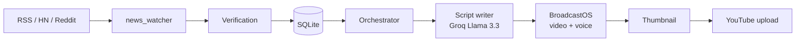

<div align="center">

# 🌍 WNX24: World News Express 24

**World News. Always.**

An autonomous, AI-powered news channel for YouTube. It finds stories, verifies sources, writes broadcast scripts, renders TV-style videos and publishes them automatically.


</div>

## Features

- Multi-agent pipeline: trend detection, verification, script writing, video, thumbnail, YouTube upload
- Source-tier verification with cross-confirmation and blocked-source lists
- 16 show formats, each with its own script style
- BroadcastOS video engine: 8 full-screen scenes, lower thirds, headline ticker, AI voice-over, 1920×1080
- Five-layer de-duplication so a story never airs twice
- 24/7 scheduling (APScheduler) and a FastAPI health dashboard

## Architecture



BroadcastOS scene order: Intro → Headline → Footage → Map → Data → AI Analysis → Summary → Outro.

## Project structure

```
├── main.py                 # Entry point
├── orchestrator.py         # Schedule and broadcast runner
├── agents/                 # Trend, verification, script, thumbnail, uploader
├── broadcast_os/           # Scenes, graphics, render engine
├── scraper/news_watcher.py # Continuous news ingestion
├── core/                   # Database and models
├── config/settings.py      # Shows, sources, channel settings
├── dashboard/              # Health dashboard
└── assets/                 # Logo, background, intro/outro
```

## Quick start

Requires Python 3.11+ and [uv](https://docs.astral.sh/uv/).

```bash
git clone https://github.com/zhdwalayat/WNX24.git
cd WNX24
uv sync
cp .env.example .env        # then add your own keys
```

Keys needed in `.env`: `GROQ_API_KEY`, `YOUTUBE_API_KEY`, `YOUTUBE_CHANNEL_ID` (optional: `UNSPLASH_ACCESS_KEY`, `PEXELS_API_KEY`).

Authorise YouTube once, using a Google Cloud **Web application** OAuth client with redirect `http://localhost:8080/oauth2callback`, saved as `config/youtube_oauth.json`:

```bash
python -m agents.uploader_agent --reauth
```

Run:

```bash
python scraper/news_watcher.py   # fill the news database
python orchestrator.py breaking  # produce and upload one test show
python main.py                   # run 24/7
```

## Shows

Breaking, Morning / Midday / Evening bulletins, Pakistan Report, Asia, Middle East, Economy, Science, Health, Conflict, World Affairs, Deep Dive, Prime Time, Week in Review, Explainer and Daily Summary. Times are in PKT; see `config/settings.py`.

## Editorial standards

Scripts follow wire-service and public-broadcaster style: active voice, a source named once, "says" rather than "claims", allegations rather than verdicts, and no hype words. Sources are tiered (Reuters, AP, BBC and similar rank highest; RT, Sputnik and PressTV are blocked).

## Disclosure

All videos are AI-generated (AI script and AI voice) and are labelled as such on YouTube.

## Roadmap

- [x] End-to-end pipeline with YouTube upload
- [x] BroadcastOS video engine
- [ ] Server deployment and monitoring
- [ ] Playlists, Shorts and Premieres
- [ ] Analytics feedback loop
- [ ] Urdu and Arabic scripts

## Security

Never commit `.env`, `config/youtube_oauth.json` or `config/youtube_token.json`. They are git-ignored by default.

