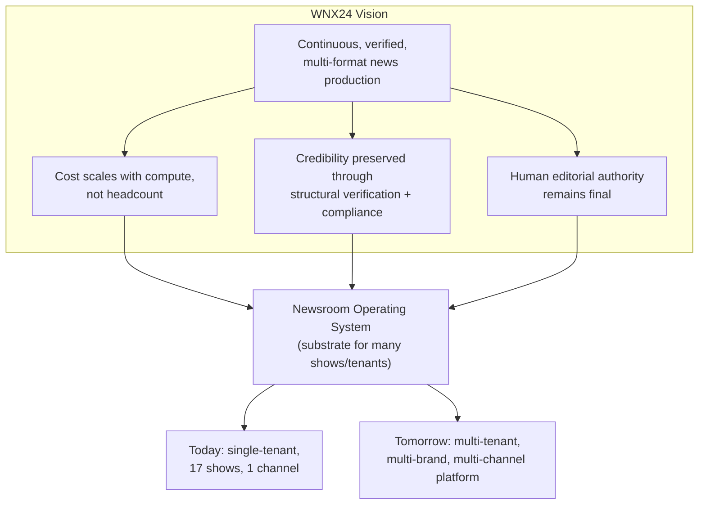
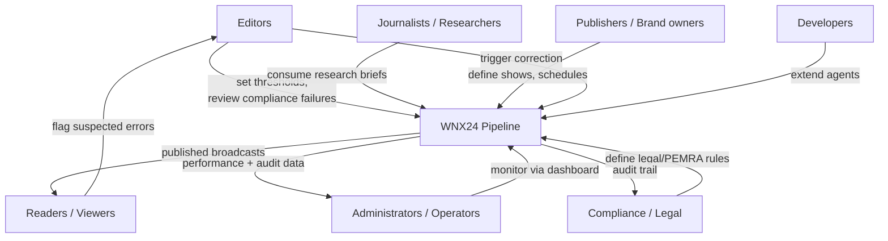
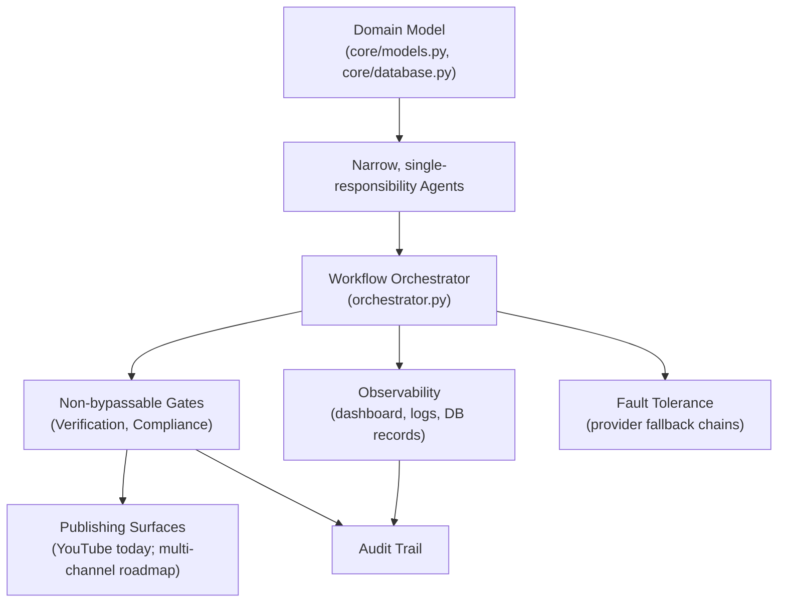
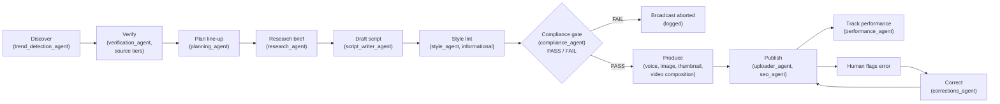

# 00 — Project Vision Specification

**WNX24 Enterprise AI Newsroom Operating System**

| Field | Value |
|---|---|
| Document class | Governing specification (constitutional) |
| Status | Adopted |
| Version | 1.0 |
| Date | 2026-07-04 |
| Owner | Chief Architect / Project Owner |
| Applies to | All engineering, product, editorial, AI, DevOps, security, and infrastructure decisions |
| Precedence | This document supersedes informal conventions. Any subsequent specification that conflicts with it must either be revised or must formally amend this document through architecture governance (§21). |

---

## 0. How to Read This Document

This is a **vision and governance specification**, not a system description. Where it describes present-day reality (Section 1, and callouts marked **[Current State]**), it describes the codebase as it exists today: a single-operator, single-tenant Python pipeline that produces automated video news broadcasts for YouTube. Where it describes multi-tenant platforms, marketplaces, SLAs, or enterprise integrations, it describes **intent and direction**, not shipped capability. Any future document, PR description, or marketing material that blurs this distinction is non-compliant with this specification.

---

## 1. Executive Summary

WNX24 ("World News. Always.") is an AI-powered newsroom system that automates the production of broadcast-style video news: story discovery, multi-source verification, script writing, narration, video assembly, thumbnail generation, and publication — governed throughout by an explicit, machine-readable editorial charter and a mandatory compliance gate.

**[Current State]** Today, WNX24 exists as a single-tenant automation pipeline (`orchestrator.py`) that runs 17 scheduled shows against a SQLite-backed story database, publishing to a single YouTube channel. It is operated by one team, deployed on one host, with one editorial policy. This is deliberate: the system is being built outward from a working, narrow, correct core rather than downward from an abstract enterprise architecture that has never shipped a broadcast.

WNX24 exists because two forces are in tension across the news industry: the economics of continuous, multi-format news production increasingly require automation, while the credibility of news depends on verification discipline that automation is naturally prone to erode. WNX24's reason for existing is to resolve that tension structurally — by making verification, attribution, and human accountability first-class, enforced components of the pipeline rather than optional editorial hygiene layered on top of a content-generation system.

WNX24 is therefore not classified internally as "a news website" or "a content-generation tool." It is classified as a **newsroom operating system**: a substrate of orchestrated agents, editorial rules, verification gates, and audit records on top of which many shows, formats, languages, and eventually tenants can run — governed by one non-negotiable charter (`agents/editorial_standards.py`).

---

## 2. Vision Statement

**In 5–10 years, WNX24 is the operating system that professional and semi-professional newsrooms run on to produce continuously verified, multi-format, multi-language news programming at a fraction of the marginal cost of a traditional broadcast operation — without lowering the evidentiary bar for what gets published.**

Success in that horizon looks like:

- Newsrooms of varying size (from a single independent journalist to a multi-brand publisher) run their editorial operations on WNX24 as a platform, not a bespoke pipeline each has to rebuild.
- The system's verification and compliance gates are trusted enough, and audited enough, that "this was produced by WNX24" is itself a credibility signal — not a caveat.
- Human editorial judgment remains the final authority on every published piece of content; AI's role has scaled in breadth (more shows, more languages, more formats) without ever being granted final editorial sign-off.
- The platform is cloud-portable, vendor-neutral, and does not depend on the continued existence of any single AI provider, video API, or hosting vendor to keep operating.
- The audit trail for any broadcast — sources, verification scores, compliance review, corrections — is complete enough to reconstruct and defend an editorial decision made years earlier.

WNX24 does **not** aim to replace human editorial judgment, eliminate journalists, or become an unsupervised publisher. Its long-term success metric is not "how much human labor was removed" but "how much verified, accountable news coverage exists that would not otherwise have been economically viable."

---

## 3. Mission Statement

WNX24's operational mission is to **orchestrate AI agents to perform the mechanical and analytical labor of newsroom production — discovery, verification scoring, drafting, narration, assembly, and distribution — while reserving editorial authority, correction, and final publication accountability to explicit, auditable, human-defined rules and human review points.**

Every agent in the system exists to serve one of these mission functions. An agent that does not map to a defined newsroom function (discovery, verification, drafting, review, production, distribution, or governance) does not belong in the pipeline.

---

## 4. Product Philosophy

WNX24 is not a news website. A news website is a publishing surface: it renders content that was produced elsewhere. WNX24 is the **production system** — the newsroom itself, expressed as software — for which a website, a YouTube channel, a podcast feed, or an app are merely output surfaces.

This distinction is why WNX24 is architected as an **Enterprise AI Newsroom Operating System** rather than a content management system (CMS) with AI features bolted on:

| Traditional news website | WNX24 |
|---|---|
| Stores and renders articles/media | Produces, verifies, and governs the production of media |
| Editorial workflow is human-driven, tool-assisted | Editorial workflow is agent-driven, human-governed |
| One publishing surface (the website) | Many publishing surfaces (YouTube today; multi-channel by design) |
| Verification is a human editorial process | Verification is a scored, tiered, machine-enforced pipeline stage |
| "AI" is a feature (auto-summarize, auto-tag) | AI agents *are* the production workforce; humans are the governance layer |
| Scale is bounded by headcount | Scale is bounded by verified source supply and compute, not headcount |

An operating system provides a substrate other programs run on top of, plus the guarantees (resource isolation, scheduling, security boundaries) those programs can rely on. WNX24 aims to provide the newsroom equivalent: a substrate — scraping, verification, drafting, compliance, production, distribution, correction — that individual "shows" (today) and eventually individual tenants/brands (roadmap) run on top of, relying on the same non-negotiable guarantees: nothing publishes without clearing verification and compliance, and every publication is attributable and correctable.

---

## 5. Core Values

Each value below is a constraint on architecture and process, not an aspiration to be traded off under deadline pressure.

### 5.1 Accuracy before speed
The `breaking` show format exists specifically to prove that even the fastest, most time-pressured format still passes through verification scoring and the compliance gate. No show configuration, schedule pressure, or business goal justifies bypassing `verification_agent.py` or `compliance_agent.py`. Speed is a property of the pipeline's engineering (parallelism, caching, low-latency inference); it is never achieved by skipping governance stages.

### 5.2 Verification before publication
A story does not become broadcast-eligible by being scraped; it becomes eligible by clearing a confidence threshold (`min_confidence_score`) computed from cross-source confirmation, source-tier reliability, and PR-language penalties. Tier 5 sources (rumor, anonymous, propaganda outlets) are hard-blocked at the scoring layer, not by editorial convention.

### 5.3 Transparency
Every editorial decision must be traceable to a rule, a score, or a human action — never to an opaque model preference. The journalism charter (`agents/editorial_standards.py`) is a single, shared, readable source of truth consumed by both the drafting agent and the review agent, specifically so the two cannot silently drift apart.

### 5.4 Accountability
Mistakes are correctable, and corrections are public by design, not by exception. `agents/corrections_agent.py` exists as a first-class agent, not a support-ticket workaround, precisely so that "we published a correction" is as structurally supported as "we published a broadcast."

### 5.5 Human oversight
Automation removes mechanical labor, not editorial authority. Every hard gate in the pipeline (compliance review) blocks automatically; every soft signal (style linting) surfaces to a human rather than silently correcting itself. Corrections are exclusively human-triggered (§13).

### 5.6 Editorial independence
The compliance and verification logic is a function of journalistic principle and legal risk (defamation, PEMRA restrictions, unproven claims), not of what is commercially convenient to publish. No monetization, growth, or engagement objective may be encoded into the verification or compliance layers.

### 5.7 Responsible AI
AI agents are given narrow, auditable roles (draft, score, review, render) rather than open-ended authority. See Section 12 (AI Philosophy) for the explicit boundary between automation and editorial authority.

### 5.8 Security by design
Credentials, tokens, and API keys are configuration, never code. OAuth tokens auto-refresh rather than being long-lived static secrets where the underlying API supports it. Security posture is designed in at the architecture layer (Section 10), not retrofitted.

### 5.9 Observability
Every pipeline run must be inspectable while it happens (the "Control Room" dashboard, live pipeline logs) and reconstructable after the fact (the `broadcasts`, `performance`, and `corrections` tables). A pipeline stage that cannot be observed is treated as a defect, not a missing feature.

### 5.10 Maintainability
One codebase, one charter, one set of agent contracts. Duplication of editorial logic across agents is treated as a correctness risk (drift), not a style preference — this is why `editorial_standards.py` is shared rather than copied.

---

## 6. Strategic Goals

| Horizon | Goal | Measurable outcome |
|---|---|---|
| Short-term (0–6 months) | Harden the single-tenant pipeline: reliability of the 17-show schedule, resilience to upstream API failures (Groq quota, RSS feed death, YouTube upload caps) | ≥95% of scheduled shows produce a publishable broadcast or a clean, logged skip (no silent failures); documented fallback path for every external dependency |
| Short-term (0–6 months) | Close observability gaps | 100% of broadcasts have a reconstructable audit trail (sources → score → script → compliance verdict → publish result) queryable from the database |
| Medium-term (6–18 months) | Multi-language support | `translation_agent.py` wired into at least one live show end-to-end, with compliance review re-run per target language |
| Medium-term (6–18 months) | Multi-channel distribution | At least one non-YouTube distribution surface (e.g., podcast RSS or a second video platform) live in production, reusing the same verified-story pipeline |
| Medium-term (6–18 months) | Formal corrections SLA | Median time from correction flagged to correction published < defined target (to be set once volume data exists) |
| Long-term (18+ months) | Multi-tenant foundation | Architecture supports a second, isolated editorial tenant (separate charter parameters, separate publishing identity) without forking the codebase |
| Long-term (18+ months) | Third-party agent extensibility | A documented contract exists for adding a new agent (e.g., a new verification source, a new distribution target) without modifying orchestrator core logic |

Goals are ordered by dependency, not just time. Multi-tenant and marketplace goals (Section 14) are explicitly gated behind proving single-tenant reliability first — WNX24 does not pursue platform breadth at the cost of the verification guarantees in Section 5.

---

## 7. Product Identity

| Characteristic | What it means for WNX24 | Why it matters |
|---|---|---|
| AI-first | Agents perform discovery, drafting, scoring, and review as the default workforce, not an assistive add-on | The economic case for WNX24 depends on production cost scaling with compute, not headcount |
| Workflow-centric | The `orchestrator.run_broadcast` pipeline is the organizing abstraction, not any single agent or model | Newsrooms think in workflows (assign → draft → review → publish); the software should mirror that mental model |
| Multi-agent | Each newsroom function (scrape, verify, research, draft, style-lint, compliance, voice, image, thumbnail, upload, correct) is an independently testable agent with a narrow contract | Narrow agent contracts are independently verifiable, replaceable, and auditable; a monolithic "do everything" model is none of those things |
| Modular | Video assembly, story sourcing, and distribution are swappable subsystems (e.g., `video_composer.py` vs. `avatar_agent.py` fallback; multiple image-sourcing providers with defined fallback order) | Vendor and provider outages must degrade gracefully, not halt the newsroom |
| Extensible | Agents not yet wired into the daily pipeline (`translation_agent.py`, `social_media_agent.py`) exist as stable interfaces precisely so they can be activated without a redesign | Roadmap items should be additive, not require rearchitecting the core |
| API-first (roadmap) | Dashboard today exposes control and correction via HTTP endpoints; this surface is the seed of a future programmatic integration layer | Enterprise customers and third-party tooling integrate against APIs, not internal function calls |
| Cloud-native (roadmap) | Not yet true of the current single-host deployment; targeted architectural property for the platform horizon (Section 14) | Required for multi-tenant scale and availability guarantees the vision commits to |
| Event-driven (roadmap) | Current scheduling is cron/interval-based (APScheduler); event-driven triggering (e.g., breaking-news push rather than 5-minute poll) is a stated architectural direction, not current behavior | Reduces latency and coupling as the platform grows past a single scheduler process |
| Enterprise-ready (roadmap) | Current system is operated by a single team; enterprise readiness (multi-tenant isolation, SLAs, formal support) is a long-term goal, not a present claim | Prevents overstating current maturity to future stakeholders |

---

## 8. Stakeholders

| Stakeholder | Primary need from WNX24 |
|---|---|
| Editors | Confidence that nothing publishes without clearing verification and compliance; visibility into what was published and why; a fast, low-friction way to flag and correct errors |
| Journalists / researchers | Trustworthy source material and research briefs (`research_agent.py`) that make their judgment calls faster, not decisions made silently on their behalf |
| Publishers (channel/brand owners) | Consistent output cadence across shows; brand-safe content (compliance gate); visibility into performance (`performance_agent.py`) |
| Readers / viewers | Accurate, attributed, correctable news; clear indication when a correction has been issued |
| Administrators / operators | Operational visibility (dashboard, `/health` endpoint, logs); predictable failure modes and fallback behavior rather than silent breakage |
| AI agents (as system participants) | Well-defined, narrow contracts (inputs, outputs, failure modes) so they can be tested, replaced, and reasoned about in isolation |
| Developers | A codebase where editorial rules live in one place (`editorial_standards.py`), agent boundaries are clear, and adding a capability doesn't require touching unrelated agents |
| System operators / SRE | Observable, debuggable failure paths — every external dependency (Groq, YouTube, RSS feeds, TTS) has a documented fallback rather than an unhandled exception |
| Enterprise customers (roadmap) | Multi-tenant isolation, SLAs, auditability sufficient for their own compliance obligations |
| Compliance / legal teams | A queryable record of what was checked, by what rule, with what verdict, for every broadcast — sufficient to defend an editorial decision after the fact |

---

## 9. Architectural Philosophy

### 9.1 Separation of concerns
Each pipeline stage (source discovery, verification, research, drafting, style review, compliance review, voice, imagery, composition, upload, performance tracking, correction) is a distinct agent module with a single responsibility. No agent should need to know the internal logic of another agent's stage — only its input/output contract.

### 9.2 Loose coupling, high cohesion
Agents communicate through well-defined data structures (Pydantic models in `core/models.py`) and the database, not through direct cross-imports of each other's internals. Within an agent, logic stays cohesive to that agent's single responsibility (e.g., all verification-scoring logic lives in `verification_agent.py`, not scattered across the drafting agent).

### 9.3 Clean architecture / domain-driven design
The domain (newsroom concepts: story, verification score, script, broadcast, correction, show) is modeled explicitly in `core/models.py` and `core/database.py`, independent of any specific AI provider, video library, or distribution API. Swapping Groq for another LLM provider, or YouTube for another distribution target, should not require changing the domain model.

### 9.4 Workflow orientation
The orchestrator is the authoritative description of "what a broadcast is": a sequence of named stages with defined fallback behavior at each stage. Any new capability is expressed as a new stage or a new fallback within this workflow model, not as a side-channel bypassing it.

### 9.5 Scalability
Today, scale is bounded by a single host and a single scheduler process. The architecture must not preclude horizontal scale (multiple hosts, distributed scheduling, multi-tenant isolation) as a later evolution — but it must not pay that complexity cost before it is needed (Section 6).

### 9.6 Fault tolerance
Every external dependency has an observed and intentional fallback: Groq model-quota exhaustion falls back to a secondary model; the primary video pipeline falls back to the legacy avatar pipeline; image sourcing falls through a provider chain ending in a generated card; real YouTube upload falls back to mock upload. Fault tolerance is achieved through explicit, logged fallback paths — never through silently swallowing an error.

### 9.7 Observability
Pipeline execution must be visible in real time (dashboard live log) and reconstructable after the fact (database records: `broadcasts`, `performance`, `corrections`). A capability that cannot be observed is not considered production-ready.

### 9.8 Security
Secrets are configuration (`.env`, OAuth token files), never hardcoded. OAuth flows favor auto-refreshing tokens over long-lived static credentials. Compliance and verification logic must not be bypassable via configuration flag in production paths.

### 9.9 Auditability
Every publication decision must be traceable: which sources contributed, what verification score resulted, what the compliance verdict was, who (if anyone) issued a correction. This is a hard architectural requirement, not a reporting nicety — it is the mechanism by which WNX24's core value of accountability (§5.4) is actually enforced rather than merely stated.

---

## 10. Editorial Philosophy

WNX24's editorial governance is enforced computationally, not aspirationally. The nine-principle journalism charter — Accuracy First, Truth Over Opinion, Neutral Language, Multiple Sources, Attribution, Transparency, Accountability, Independence, Public Interest (`agents/editorial_standards.py`) — is the shared input to both the agent that drafts content and the agent that reviews it, so that drafting and review cannot drift into inconsistent standards over time.

- **Accuracy** is operationalized as a numeric confidence score derived from source tier and cross-source confirmation (`verification_agent.py`), not a subjective drafting-time judgment call.
- **Evidence** is gathered explicitly before drafting (`research_agent.py`) and treated strictly as background context — never as a mandate that forces content into the script, since story-format rules (e.g., `breaking`'s zero-analysis rule) take precedence.
- **Verification** is tiered by source reliability (Section 10.1) and enforced with format-specific strictness — the `breaking` format applies a stricter score floor to lower-tier sources precisely because it has the least time to verify before airing.
- **Corrections** are a first-class, human-triggered workflow (`agents/corrections_agent.py`), not an informal edit-in-place. A correction is drafted plainly and non-defensively, published to the original content's description and as a visible comment, and recorded regardless of whether public republishing succeeded.
- **Transparency** means the rules that governed a piece of content are inspectable, not just the content itself.
- **Neutrality** is enforced at review time by the compliance agent checking for promotional/commercial bias and unproven claims stated as fact — not left to the drafting model's discretion.
- **Human review** is mandatory at the compliance stage for every single broadcast, with no configuration path that makes it conditional.

### 10.1 Source reliability tiers

| Tier | Description | Editorial handling |
|---|---|---|
| 1 | Government/IGO statements, official documents, direct reporting | Highest trust; detected by authoritative domain patterns |
| 2 | Major wire services and international newsrooms | High trust, used directly |
| 3 | Verified research institutes, universities, NGOs | High trust, used directly |
| 4 | Eyewitness content, social media, aggregators | Requires cross-source confirmation before reaching `verified` status |
| 5 | Rumor, anonymous, propaganda outlets | Hard-blocked; confidence forced to zero, never publishable |

### 10.2 AI's place in editorial operations
AI performs the mechanical and first-draft analytical work: scraping, scoring, summarizing, drafting, linting. AI does **not** perform the two acts that constitute editorial authority: deciding that a legally or ethically risky story is safe to publish (the compliance gate is a hard block, not an AI-overridable soft signal), and deciding, after the fact, that no correction is warranted (corrections are exclusively human-triggered — see Section 13).

---

## 11. AI Philosophy

**What AI does in WNX24:**
- Discovers and scores candidate stories (trend detection, verification scoring).
- Selects and orders a show's story line-up from a pool of eligible candidates.
- Gathers background research context for drafting.
- Drafts scripts against explicit format and charter rules.
- Lints drafts against house style (informational).
- Reviews drafts against legal/ethical/charter rules and renders a pass/fail verdict.
- Synthesizes narration, sources imagery, and assembles video.
- Generates headlines, thumbnails, and SEO metadata.
- Drafts (but does not autonomously decide to publish) corrections once a human has flagged an error.
- Tracks and reports performance metrics.

**What AI must never do:**
- Publish content that has failed the compliance gate, under any configuration, business pressure, or retry logic.
- Decide unilaterally that a published error does not require a correction — that determination, and the decision to trigger the correction workflow, is exclusively human.
- Fabricate or launder an unverified (Tier 5, or unconfirmed Tier 4) source into published content.
- Alter or bypass the shared journalism charter at inference time — the charter is a fixed input, not a negotiable parameter a prompt can override.
- Operate as the final, unreviewable authority on any content that has active, credible legal or safety risk flagged by the compliance stage.

**Automation vs. editorial authority:** automation is the execution of a defined, auditable process (discovery, drafting, scoring, review-against-rules, assembly, distribution). Editorial authority is the power to decide what the newsroom's standards *are*, and to override the system's default verdict when human judgment says otherwise. WNX24's architecture grants AI unlimited scope to automate the former and zero scope to exercise the latter.

---

## 12. Human-in-the-Loop Philosophy

Human approval is required, structurally, at these points:

1. **Compliance failure escalation** — a broadcast that fails the compliance gate is aborted, not queued for silent retry; a human reviews why before any related content proceeds.
2. **Correction initiation** — the system does not self-detect that a published broadcast was wrong. A human must flag it (`POST /correct/{story_id}`) before `corrections_agent.py` acts.
3. **Configuration of editorial thresholds** — `min_confidence_score`, `min_score_tier4`, and charter rules are human-set configuration, not values an AI agent tunes autonomously.
4. **Enabling paid/higher-risk capabilities** — e.g., toggling the HeyGen avatar path, or any future capability with materially different cost, likeness, or risk profile, requires an explicit human configuration change, not an automatic upgrade.

Approval checkpoints are designed to be **configurable, not fixed at one universal strictness level** — a future multi-tenant deployment may set stricter or looser thresholds per tenant's editorial policy, but the existence of a compliance gate and a human-triggered correction path is non-configurable (constitutional, per this document).

---

## 13. Long-Term Product Roadmap

| Stage | Description |
|---|---|
| 1. AI-assisted newsroom **(current)** | Single tenant, single publishing surface, 17 shows, one editorial charter, one operating team |
| 2. Enterprise newsroom | Formal SLAs on schedule reliability and corrections turnaround; complete audit trail; multi-language support live |
| 3. Multi-brand platform | Multiple shows/brands under one operator with distinct visual identity and schedule, sharing one verification/compliance substrate |
| 4. Multi-tenant SaaS | Isolated tenants (separate operators, separate editorial parameters, separate publishing identities) on shared infrastructure |
| 5. White-label deployment | Tenants can present WNX24-produced content under their own brand with no visible WNX24 attribution requirement |
| 6. Third-party ecosystem | Documented contracts allow external developers to add agents (new sources, new distribution targets, new languages) without core changes |
| 7. Marketplace | Discoverable, vetted third-party agents/integrations tenants can opt into |
| 8. Workflow customization | Tenants configure their own show schedules, verification thresholds (within charter-mandated floors), and pipeline stage composition |
| 9. Global deployment | Multi-region operation for latency, data residency, and regional-compliance requirements |

Each stage is gated on the reliability and trust guarantees of the stage before it — WNX24 does not pursue Stage *N+1* breadth at the cost of Stage *N* correctness.

---

## 14. Quality Attributes

| Attribute | Definition for WNX24 | Why it matters |
|---|---|---|
| Reliability | Scheduled shows produce a broadcast or a clean, logged, non-silent skip | A newsroom that silently fails to air is worse than one that visibly fails |
| Availability | Dashboard and health endpoint reflect true pipeline state at all times | Operators must be able to trust "green" as actually green |
| Maintainability | One shared charter, narrow agent contracts, no duplicated editorial logic | Prevents silent drift between drafting and review standards |
| Security | Secrets as configuration; auto-refreshing credentials; no bypassable gates | Newsroom credibility depends on the system not being trivially compromised |
| Performance | Pipeline stages complete within the time budget of the tightest show format (`breaking`, 30-minute cycle) | Breaking-news usefulness decays with latency |
| Scalability | Architecture does not preclude horizontal/multi-tenant scale, without prematurely paying that cost today | Balances current simplicity against roadmap commitments (Section 13) |
| Transparency | Rules governing any published item are inspectable, not just the item itself | Core value (§5.3) made measurable |
| Auditability | Full source → score → script → compliance verdict → publish → correction chain is queryable | Required to defend editorial decisions after the fact |
| Accessibility | Published video content includes accurate captions/metadata where the distribution surface supports it | Broadens legitimate reach without compromising editorial standards |
| Usability | Dashboard lets a non-engineer operator trigger shows, watch logs, and file corrections without touching code | Editorial staff, not just engineers, must be able to operate the newsroom |
| Testability | Every agent has a narrow, mockable contract; the test suite runs without live network calls | Enables confident change without live-broadcast risk |

---

## 15. Engineering Principles

- **SOLID** and **Clean Architecture**: agent boundaries follow single-responsibility; dependencies point toward the domain model (`core/`), not away from it.
- **Configuration over hardcoding**: show schedules, thresholds, and provider selection live in `config/settings.py` and environment variables, not inline constants — with the explicit exception that hard editorial/legal gates (compliance, Tier 5 blocking) are intentionally *not* runtime-configurable, since they are constitutional, not operational, settings.
- **Infrastructure as Code** (roadmap direction): deployment and scheduling configuration should become declarative and reproducible as the platform moves toward Section 14's later stages.
- **Automation**: anything mechanical (scraping, scoring, rendering, uploading) is automated; anything constituting editorial judgment is not (Section 11).
- **Testing**: the test suite runs without live network calls (per `README.md`), so correctness can be verified without incurring cost or broadcast risk.
- **Documentation**: architectural and editorial rules are written down in shared modules and specifications (this document; `editorial_standards.py`) rather than held as tribal knowledge.
- **Reusable components**: fallback chains (image sourcing, video pipeline, model selection) are structured as ordered, reusable provider lists, not one-off conditionals.
- **Event-driven architecture** (roadmap direction): today's interval/cron-based scheduling is a known interim mechanism, not a permanent architectural commitment.
- **API-first development** (roadmap direction): the dashboard's HTTP surface is the seed of a broader programmatic integration layer for future enterprise/tenant use.

These are mandatory because WNX24's core differentiator — trustworthy automation — collapses the moment engineering discipline (testability, auditability, non-bypassable gates) is treated as optional under deadline pressure.

---

## 16. Success Criteria

| Dimension | Metric |
|---|---|
| Editorial quality | Zero Tier-5-sourced broadcasts; 100% of broadcasts show a passing compliance verdict prior to publish |
| System uptime | Scheduler executes all configured shows on schedule, with all non-executions logged and explainable |
| Workflow reliability | Percentage of triggered shows that reach a terminal state (published or cleanly skipped) vs. crash/silent-fail |
| Automation rate | Proportion of newsroom labor hours (discovery through publish) performed without direct human drafting, tracked without conflating it with reduced human *oversight* |
| Verification accuracy | Correction rate per published broadcast, trended over time |
| Publishing latency | Time from story verified-eligible to published broadcast, per show format |
| Developer productivity | Time to add a new agent or provider fallback without modifying unrelated agents |
| Scalability | Demonstrated ability to add a show/tenant without proportional increase in operational incident rate |
| Audit completeness | Percentage of published broadcasts with a fully reconstructable source→score→script→compliance→publish→(correction) chain |

---

## 17. Constraints

- **Editorial ethics**: the nine-principle charter and PEMRA-safe handling for Pakistan-related content are non-negotiable constraints on any drafting or review logic.
- **Legal compliance**: defamation risk, unproven-claims-as-fact, and jurisdiction-specific broadcast restrictions (e.g., PEMRA) must be checked before every publish, with no exception path.
- **Budget awareness**: the system is built to run on free/low-cost tiers where viable (Groq free tier, edge-tts, Creative-Commons imagery, RSS-based Reddit access) and to degrade gracefully rather than fail when those tiers are exhausted.
- **Cloud portability**: no component should be architected such that it can only run on one specific cloud vendor's proprietary primitives.
- **Vendor neutrality**: LLM provider, video/TTS provider, and distribution API should each be swappable behind their agent's contract — evidenced today by the existing fallback design (Groq model fallback, HeyGen-vs-local video path, multi-provider image sourcing).
- **Maintainability**: a shared charter and narrow agent contracts are constraints on how new capability may be added, not just descriptions of current structure.
- **Security**: credentials are never hardcoded or committed; OAuth tokens are refreshed rather than manually rotated where the provider API supports it.
- **Data privacy**: only publicly available source material (RSS, public APIs) is ingested; no private/personal data pipeline exists in the current architecture, and any future feature touching personal data must be evaluated against this constraint before being added.

---

## 18. Risks

| Risk | Mitigation |
|---|---|
| Hallucination / misinformation in drafted scripts | Verification scoring gates story eligibility before drafting; compliance gate reviews drafted content before publish; corrections workflow provides after-the-fact remediation |
| Vendor lock-in (LLM, TTS, video, distribution) | Provider-fallback design pattern already in place (Groq model fallback, video pipeline fallback, image-provider chain); extend the same pattern to any new external dependency |
| Scaling challenges (single host, single scheduler) | Roadmap explicitly gates multi-tenant/horizontal-scale work behind proven single-tenant reliability (Section 6); no premature distributed-systems complexity |
| Technical debt from duplicated editorial logic | Structurally prevented by centralizing the charter in one shared module consumed by both drafting and review agents |
| Model drift (provider changes model behavior/quality silently) | Compliance and style review run against every draft regardless of which model produced it, providing a consistent downstream check independent of upstream model changes |
| Security risks (credential leakage, token misuse) | Secrets as configuration only; OAuth auto-refresh; no hardcoded keys |
| Legal issues (defamation, regional broadcast restriction violations) | Mandatory, non-bypassable compliance gate checked against the same charter used at drafting time |
| Operational complexity as shows/tenants grow | Roadmap stages (Section 13) are explicitly sequenced so complexity is added only when the prior stage's reliability is proven |
| Upstream dependency outages (RSS feed death, API quota exhaustion, upload caps) | Documented, logged fallback at every external dependency boundary (already implemented for Groq quota, video pipeline, image sourcing, and YouTube upload) |

---

## 19. Guiding Principles (Quick Reference)

1. Nothing publishes without clearing verification and compliance — no exceptions, no configuration bypass.
2. AI drafts and scores; humans decide what "acceptable risk" and "needs correction" mean.
3. One charter, shared by drafting and review, so standards cannot silently diverge.
4. Every external dependency has a documented, logged fallback — failures are visible, never silent.
5. Corrections are a first-class, human-triggered workflow, not an informal edit.
6. Don't build multi-tenant, event-driven, or marketplace complexity before single-tenant reliability is proven.
7. Secrets are configuration; editorial gates are constitution — know which category a setting belongs to before making it configurable.
8. If a pipeline stage can't be observed or audited, treat that as a defect, not a missing nice-to-have.
9. Describe current capability accurately; describe roadmap intent as intent (Section 0).
10. Any proposal that weakens verification, compliance, or human-triggered correction is a violation of this document, regardless of the efficiency or growth case made for it.

---

## 20. Acceptance Criteria for This Document

This specification is considered complete and fit to govern subsequent design and implementation work when:

- [x] It distinguishes explicitly between current-state capability and roadmap intent (Section 0).
- [x] It defines a non-negotiable editorial/compliance boundary that no future design may cross without formally amending this document (Sections 5, 10, 11, 19).
- [x] It identifies all current stakeholders and their needs, and names roadmap-only stakeholders (enterprise customers, compliance teams) separately (Section 8).
- [x] It defines measurable success criteria and quality attributes, not only qualitative aspiration (Sections 14, 16).
- [x] It defines constraints and risks with concrete, present-in-the-codebase mitigations rather than hypothetical ones (Sections 17, 18).
- [x] It provides a sequenced roadmap where later stages are explicitly gated on earlier-stage reliability (Sections 6, 13).
- [x] It includes a glossary and explicit assumptions so future readers do not need tribal knowledge (Sections 22, 23).
- [x] Any future document that references this one can identify, section by section, which part of that document it derives its authority from.

---

## 21. Architecture Governance

Any proposal — design document, PR, or agent behavior change — that appears to conflict with this specification must:

1. Cite the specific section of this document it conflicts with.
2. Either revise the proposal to comply, or submit a formal amendment to this document, approved by the document owner, before proceeding.
3. Not be implemented under a "temporary" or "just for now" exception — this document has no informal-exception mechanism, precisely because informal exceptions to compliance/verification gates are the primary risk this document exists to prevent (Section 18).

Claude Code and any other AI engineering assistant operating on this codebase must, before making an architectural recommendation:

- Verify the recommendation's consistency with this vision.
- Explicitly surface any conflict it identifies, rather than silently resolving it in the recommendation's favor.
- Never recommend a solution that weakens the compliance gate, the human-triggered correction requirement, or the shared-charter model, regardless of stated efficiency gains.

---

## 22. Glossary

| Term | Definition |
|---|---|
| Agent | A narrowly scoped, independently testable software component performing one newsroom function (e.g., verification, drafting, compliance review) |
| Broadcast | One completed unit of published content, corresponding to one row in the `broadcasts` table |
| Charter | The shared journalism-principle rule set (`editorial_standards.py`) consumed by both drafting and review agents |
| Compliance gate | The mandatory, non-bypassable review stage (`compliance_agent.py`) that checks a draft against the charter and legal/regional restrictions before publish is permitted |
| Correction | A human-triggered, publicly published amendment to a previously published broadcast, handled by `corrections_agent.py` |
| Show | A named, scheduled content format (e.g., `breaking`, `morning`, `primetime`) with its own cadence, length, and story-count configuration |
| Source tier | A 1–5 reliability classification applied to a scraped story's origin, used to gate verification eligibility |
| Tenant | (Roadmap) An isolated operator/brand running its own editorial configuration on shared WNX24 infrastructure |
| Verification score | A computed confidence value determining whether a story is eligible for broadcast |

---

## 23. Assumptions

- The organization operating WNX24 retains ultimate legal and editorial responsibility for published content, regardless of how much of the production pipeline is automated.
- Underlying third-party APIs (LLM inference, TTS, distribution platforms) will continue to change pricing, quotas, and terms; the fallback-chain pattern is assumed to be the durable mitigation, not any single vendor relationship.
- Multi-tenant and marketplace stages (Section 13) are assumed to require a formal legal/compliance review at the time they are undertaken, distinct from and in addition to this document.
- This document assumes a single governing charter today; multi-tenant operation will require deciding whether tenants can vary charter *parameters* (thresholds) versus charter *principles* (the nine principles themselves) — that decision is explicitly deferred to future architecture governance, not resolved here.

## 24. Future Considerations

- Formal data-residency and regional-compliance requirements once global deployment (Section 13, Stage 9) is undertaken.
- A versioned, machine-readable charter format if/when third-party or tenant-specific editorial customization is introduced, so charter changes themselves become auditable.
- Accessibility standards (captioning accuracy, language coverage) as a formal, tested quality gate rather than a best-effort property, once multi-language support ships.
- Formal SLA definitions (uptime, corrections turnaround) once there is sufficient operating history to set them meaningfully rather than aspirationally.

---

## 25. Diagrams

### 25.1 High-Level Product Vision

### 25.2 Strategic Roadmap

```mermaid
flowchart LR
    S1["1. AI-assisted newsroom\n(current)"] --> S2["2. Enterprise newsroom\nSLAs, full audit trail"]
    S2 --> S3["3. Multi-brand platform"]
    S3 --> S4["4. Multi-tenant SaaS"]
    S4 --> S5["5. White-label deployment"]
    S5 --> S6["6. Third-party ecosystem"]
    S6 --> S7["7. Marketplace"]
    S7 --> S8["8. Workflow customization"]
    S8 --> S9["9. Global deployment"]

    classDef current fill:#2b6cb0,color:#fff;
    class S1 current;
```

### 25.3 Stakeholder Relationships

### 25.4 Architectural Philosophy

### 25.5 Newsroom Operating Model

---

**End of Document.** This specification governs until formally amended per Section 21.
